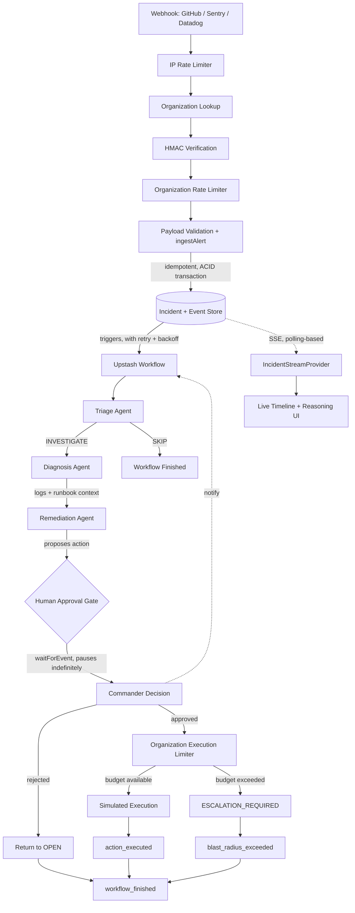

<div align="center">

# 🛡️ Sentinel OS

### Autonomous Incident Response, Gated Behind Human Approval

Sentinel receives production alerts, investigates them through a durable multi-agent workflow, streams its reasoning in real time, and proposes a remediation — but **no action is ever executed without explicit human approval.**

[](https://nextjs.org/)
[](https://prisma.io/)
[](https://neon.tech/)
[](https://tailwindcss.com/)
[](https://upstash.com/)
[](https://upstash.com/)

</div>

---

<div align="center">


<p align="center"><em>
Simulate an alert → watch the agent investigate in real time → approve the proposed remediation → the paused durable workflow resumes automatically.
</em></p>

</div>

## Why Sentinel?

Most "AI DevOps" tools are a chatbot wrapper: one API call, a summary, done. If the
process crashes mid-summary, you start over. If two webhooks arrive for the same
incident, you get two responses. Nothing about that is durable, and nothing about it
is safe to point at production.

Sentinel is built differently — as a **durable, resumable workflow**, not a single
LLM call:

- **Durable investigation.** Upstash Workflow checkpoints each step and resumes from
  the last completed one after a crashed worker, a network blip, or a retryable
  failure — not from scratch.
- **Idempotent ingestion.** Database constraints deduplicate repeated webhook
  deliveries, so a retried webhook never creates a second incident.
- **Tool-assisted diagnosis.** Agents reason over incident context, a mocked log
  tool, and runbook passages retrieved through semantic search — a real
  `reason → act → observe → reason again` loop, not one-shot summarization.
- **Human authorization.** The workflow pauses at a durable approval gate. Not a UI
  convention — an architectural constraint. An `action_approved` event has to exist
  in the database before an action can run, full stop.
- **Execution guardrails.** Redis-backed rate limits constrain public webhook
  traffic, organization ingestion, Commander approval requests, and post-approval
  execution volume.

> **Scope note:** Remediation execution is currently simulated. The approval gate
> and blast-radius controls demonstrate Sentinel's safety boundaries; they do not
> mean Sentinel is already applying arbitrary changes to production infrastructure.

## Architecture

<div align="center">


<br /><br />
<p align="center">
<i>High-level architecture showing how request handling transitions into durable workflow orchestration. The detailed execution flow is shown below.</i>
</p>

</div>



After the incident is persisted, Sentinel triggers an Upstash Workflow. Its agent
pipeline — Triage, Diagnosis, Remediation, and the approval wait — runs as
**durable, checkpointed steps**, so a completed stage is reused rather than
re-run if the workflow retries or resumes. The Human Approval Gate is a **real
pause**: the workflow sits idle in the cloud, sometimes for hours, until a
Commander acts.

Webhook requests are rate-limited by IP *before* organization lookup, so an
unauthenticated caller can't burn a database query per guess. The organization-level
limiter runs only *after* HMAC verification, so unsigned traffic can't consume a
legitimate organization's ingestion budget. After approval, a separate
organization-level execution limiter runs immediately before execution — if that
budget is exceeded, Sentinel records an explicit escalation rather than silently
executing or silently dropping the approved action.

## The Agent Pipeline

| Agent | Job | Implementation |
|---|---|---|
| **Triage** | Decide whether an alert warrants investigation | Binary `INVESTIGATE` / `SKIP`, evaluating the incident's title, severity, and description |
| **Diagnosis** | Identify root cause using logs + runbooks | Mocked log tool + `pgvector` semantic retrieval over chunked runbooks (top-k, tenant-scoped); each chunk independently fenced and scanned before reaching the prompt |
| **Remediation** | Propose one concrete fix and a risk level | Structured JSON proposal (`action`, `riskLevel`), validated with Zod before it's ever shown to a human |

## Features

🏢 **Multi-tenant SaaS foundation**
Auth.js v5 (GitHub OAuth), org-scoped data access enforced at the data-access-layer
level (not just the UI), three RBAC roles — Commander, Engineer, Observer — and
encrypted-at-rest vaults for integration tokens.

⚙️ **Durable agent orchestration**
Upstash Workflow + QStash. Idempotent steps, automatic retry on transient failure,
and a self-healing recovery path for the rare case where an incident is written to
the DB but the workflow trigger itself fails to fire.

🛡️ **Human-in-the-loop safety, enforced server-side**
The approval gate isn't a disabled button — it's a `waitForEvent` pause in the
workflow itself, and the Server Action that resolves it re-checks Commander
authorization, organization membership, incident ownership, and the
`AWAITING_APPROVAL` state on every call. The current execution path is simulated
and cannot proceed through the workflow without an accepted human decision.

📡 **Real-time Operations UI**
Agent reasoning, tool calls, and proposed actions stream into the incident view via
Server-Sent Events as they're written — no manual refresh. A shared
`IncidentStreamProvider` powers synchronized timeline and reasoning panes through
Next.js Parallel Routes, while Intercepting Routes let Commanders and Engineers
inspect an incident in a dashboard modal without losing context. Dashboards stay
lightweight through conditional polling that only runs while an incident is
actually active.

🧠 **Retrieval-augmented diagnosis**
Runbooks are chunked, embedded, and stored in PostgreSQL with `pgvector`. Diagnosis
retrieves relevant passages using cosine similarity and organization-scoped queries
instead of loading every runbook into the prompt. Retrieved content remains
untrusted: chunks are fenced and scanned independently, and advisory tripwire
events surface suspicious content or likely unretrieved-runbook citations for
Commander review.

🚦 **Rate limits and blast-radius control**
Redis-backed sliding-window limits protect four independent boundaries:

| Boundary | Limit | Window |
|---|---:|---|
| Public webhook, per client IP | 30 requests | 10 seconds |
| Webhook ingestion, per organization | 60 requests | 60 seconds |
| Commander approval, per user | 10 actions | 60 seconds |
| Remediation execution, per organization | 10 executions | 1 hour |

Webhook ingestion and execution **fail closed** if their required limiter can't
operate. Approval limiting follows a deliberately different policy: an explicit
rate-limit denial is still rejected, but a Redis infrastructure failure does not
independently remove the human-approval path — existing Commander authorization
and incident-state checks remain mandatory either way. When an approved action
exceeds its organization's execution budget, Sentinel sets the incident to
`ESCALATION_REQUIRED`, records `blast_radius_exceeded`, never emits
`action_executed`, and emits a terminal `workflow_finished` event with that reason.
See [`docs/Phase 6.md`](./docs/Phase%206.md) for the full design.

🔐 **Prompt safety**
The system prompt separates trusted instructions from untrusted incident content,
logs, runbooks, and retrieved chunks — every untrusted block is independently
nonce-fenced. Prompt-injection detection is an advisory tripwire: it records
suspicious inputs for Commander review rather than treating a heuristic match as
proof that content is safe, or as a substitute for the approval gate.

## Product Walkthrough

<div align="center">


<p align="center">
<i>Commander Bridge — incidents at varying severity and status, updating live via gated dashboard polling.</i>
</p>
<br /><br />


<p align="center">
<i>Incident detail opened as a modal via Next.js Intercepting Routes — dashboard context stays visible underneath.</i>
</p>
<br /><br />


<p align="center">
<i>Live agent reasoning streamed via Server-Sent Events (SSE). Triage, Diagnosis, and Remediation appear as the workflow progresses — no refresh required.</i>
</p>

</div>

## Tech Stack

**Implemented**

| Layer | Choice |
|---|---|
| Framework | Next.js 16 — App Router, Server Actions, Parallel & Intercepting Routes |
| Language & validation | TypeScript, Zod |
| Database | PostgreSQL (Neon serverless) |
| ORM | Prisma 7, Edge Driver Adapters |
| Auth | Auth.js v5, GitHub OAuth |
| Authorization | Database-backed organization membership and role checks |
| Styling | Tailwind CSS v4 |
| Orchestration | Upstash Workflow, QStash |
| AI | OpenAI SDK against Google Gemini's OpenAI-compatible endpoint |
| Embeddings & retrieval | `gemini-embedding-001`, `pgvector` (HNSW, cosine similarity) |
| Real-time | Server-Sent Events (polling-based, one connection per incident) |
| Rate limiting | Upstash Redis, sliding window — webhook (IP + org), Commander approval, and execution blast-radius |
| Testing | Vitest |

**Incoming (Phase 6, remaining)**

| Layer | Choice |
|---|---|
| Accessibility | `aria-live` regions on the live reasoning feed |
| Observability | Per-segment error boundaries |
| Public metadata | `sitemap.ts`, `robots.ts`, OG images for postmortem pages |
| CI | Automated pipeline (lint, typecheck, test on push) |

## Roadmap

- [x] **Phase 0** — Foundations: Core SaaS, Edge RBAC, baseline architecture
- [x] **Phase 1** — Core CRUD
- [x] **Phase 2** — Ingestion & Event Store
- [x] **Phase 3** — Durable Agent Orchestration
- [x] **Phase 4** — Real-Time UI: SSE streaming, Parallel/Intercepting Routes, live approval reconciliation
- [x] **Phase 5** — AI Intelligence: `pgvector` RAG over runbooks
- [ ] **Phase 6** — Hardening ([details](./docs/Phase%206.md))
  - [x] Webhook (IP + org) and Commander approval rate limiting
  - [x] Organization-level execution blast-radius control and escalation behavior
  - [ ] Accessibility (`aria-live` on the live feed)
  - [ ] Per-segment error boundaries
  - [ ] Public postmortem metadata (`sitemap.ts`, `robots.ts`, OG images)
  - [ ] CI pipeline

## Getting Started

### Prerequisites

- Node.js and npm
- A PostgreSQL database (the documented setup uses Neon)
- GitHub OAuth App credentials
- Upstash QStash credentials
- Upstash Redis REST credentials (required — the rate limiters depend on them)
- A Google AI Studio API key
- `psql`, for the one-time `pgvector` setup below

### 1. Clone & install

```bash
git clone https://github.com/Gurashish73/sentinel.git
cd sentinel
npm install
```

### 2. Configure environment

```bash
cp .env.example .env
```

Fill in `.env`:

```bash
# App
NEXT_PUBLIC_APP_URL=          # use ngrok/cloudflared for local dev — see note below

# Database (Neon)
DATABASE_URL=
DIRECT_URL=

# Auth (GitHub OAuth App)
AUTH_SECRET=                  # npx auth secret
AUTH_GITHUB_ID=
AUTH_GITHUB_SECRET=

# Encryption (webhook secrets at rest)
ENCRYPTION_KEY=               # openssl rand -hex 32

# Durable workflow (Upstash)
QSTASH_URL=
QSTASH_TOKEN=
QSTASH_CURRENT_SIGNING_KEY=
QSTASH_NEXT_SIGNING_KEY=

# Rate limiting & blast-radius control (Upstash Redis) — required
UPSTASH_REDIS_REST_URL=
UPSTASH_REDIS_REST_TOKEN=

# AI (Google AI Studio)
GEMINI_API_KEY=
AGENT_MODEL=                  # optional, defaults to gemini-3.1-flash-lite
AGENT_EMBEDDING_MODEL=        # optional, defaults to gemini-embedding-001
```

> Verify your chosen model supports the OpenAI-compatible endpoint before changing
> `AGENT_MODEL` — newly created Gemini API keys are restricted from older model
> generations. See [Google's OpenAI compatibility docs](https://ai.google.dev/gemini-api/docs/openai).

### 3. Set up the database

```bash
npx prisma db push
```

Enable `pgvector` and create the HNSW index — Prisma's `Unsupported()` type can't do
this for you, so run it once against the database referenced by `DIRECT_URL`:

```bash
psql "$DIRECT_URL" -c '
  CREATE EXTENSION IF NOT EXISTS vector;
  CREATE INDEX IF NOT EXISTS runbook_chunk_embedding_idx
  ON "RunbookChunk" USING hnsw (embedding vector_cosine_ops);
'
```

### 4. Start the dev server

```bash
npm run dev
```

> **Local development note:** Upstash QStash needs a publicly reachable URL to
> deliver workflow steps and webhooks — tunnel `localhost` with ngrok or
> cloudflared and point `NEXT_PUBLIC_APP_URL` at the tunnel. `QSTASH_URL` is the
> QStash service endpoint, not your tunnel URL — keep it pointed at Upstash.

### Local verification

```bash
npm run test
npm run lint
npm run build
```

Phase 6 regression tests cover limiter ordering, approval behavior during Redis
failures, escalation when the execution budget is exceeded, and serialization-safe
durable workflow results. These checks don't replace verifying environment
configuration and proxy-header handling in your actual deployment environment.

## Security & Deployment Notes

- **Human approval remains mandatory.** Agent output is a proposal, never
  authorization to execute.
- **Forwarded IP headers must be trusted correctly.** `getClientIp()` reads
  `x-forwarded-for` and `x-real-ip`; your reverse proxy must sanitize or overwrite
  those headers before they reach the app. Blindly trusting client-supplied
  forwarding headers would weaken IP-based rate limiting.
- **Redis failure policies are intentionally asymmetric.** Webhook ingestion and
  execution fail closed. Approval rate limiting preserves the human-approval path
  during a Redis outage, while keeping database-backed authorization and
  incident-state checks mandatory regardless.
- **Retrieved documents remain untrusted.** Prompt-injection tripwires improve
  visibility into suspicious content; they're heuristic, and a `false` result means
  "nothing obvious," not "provably safe."
- **Remediation is simulated.** Don't treat the current execution path as a
  production infrastructure executor.

## Project Documentation

- [`docs/project-phases.md`](./docs/project-phases.md) — phase roadmap and completion tracker
- `docs/Phase 0.md` through [`docs/Phase 6.md`](./docs/Phase%206.md) — per-phase implementation notes
- [`docs/Phase 5 - RAG Trust Model.md`](./docs/Phase%205%20-%20RAG%20Trust%20Model.md) — trust model for retrieved context